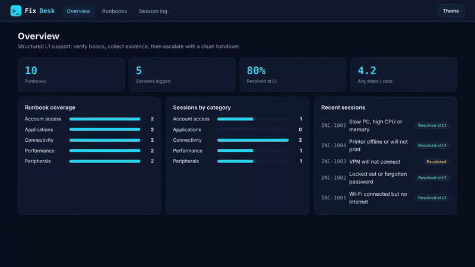

# FixDesk · Endpoint Troubleshooting & Remote Support Lab

**[Live demo](https://prithvirajbchavan.github.io/endpoint-support-lab/)**

A structured L1 support runbook library with a session log. It is built around the way a service desk really works:
verify the basics, collect evidence, then either resolve or escalate with a clean handover.

## Features
- 10 runbooks across 5 categories: account access, applications, connectivity, performance, peripherals
- Each runbook has symptoms, ordered diagnostic checks (basic to deeper), a resolution and escalation criteria
- Progress tracking on every check, then **Resolve at L1** or **Escalate** logs the case
- Session log with steps taken and outcome, exportable as CSV
- Overview dashboard: runbook coverage, sessions by category, L1 resolution rate
- Light and dark themes

## Run
Open `index.html` in a browser. No build step and no backend. Data is stored in your browser (localStorage).

Built with plain HTML, CSS and JavaScript.
